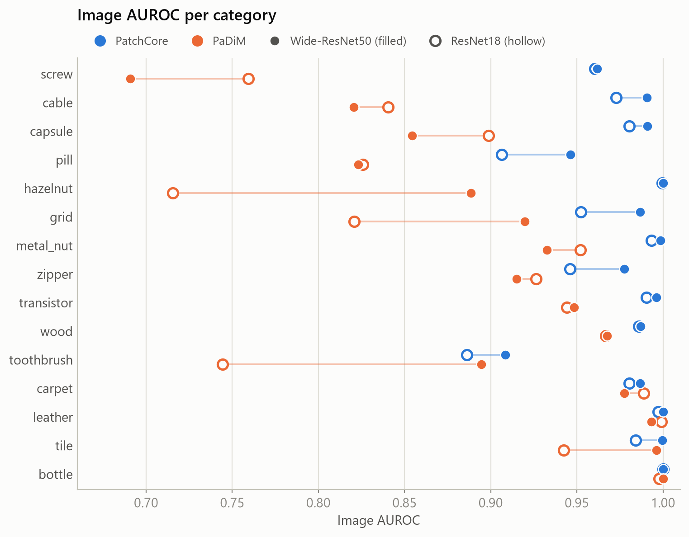
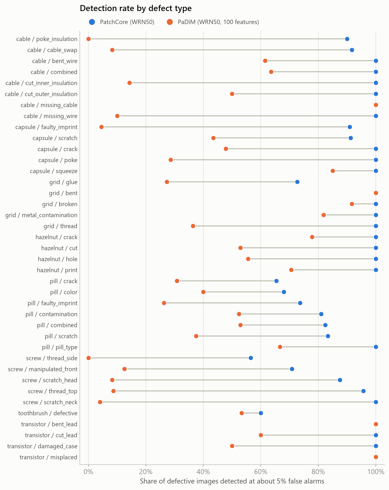
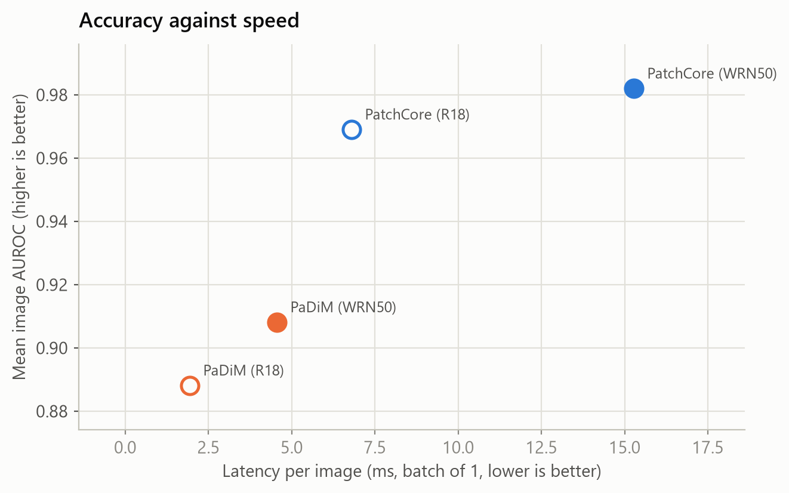

# Industrial anomaly detection: PatchCore vs PaDiM on MVTec AD

Which matters more for finding defects without defect examples in training: the **method** or the **backbone**?
I trained PatchCore and PaDiM, each with a Wide-ResNet50 and a ResNet18 backbone, on all 15 MVTec AD categories (60 runs, one seed each) using [anomalib](https://github.com/open-edge-platform/anomalib), then looked at where the models fail and what they cost to run.

## Headline result

**The method matters far more than the backbone.** Switching from PaDiM to PatchCore adds about 0.07 to 0.08 image AUROC. Switching from ResNet18 to Wide-ResNet50 adds only 0.01 to 0.02.

Mean over the 15 categories:

| Image AUROC | WRN50 | R18 |
|---|---|---|
| PatchCore | 0.982 | 0.969 |
| PaDiM | 0.908 | 0.888 |

| Pixel AUROC | WRN50 | R18 |
|---|---|---|
| PatchCore | 0.980 | 0.975 |
| PaDiM | 0.962 | 0.960 |



## What else I found

- **PatchCore wins almost everywhere.** With Wide-ResNet50 it is ahead on 14 of 15 categories for image AUROC (one tie, `bottle`) and on all 15 for pixel AUROC.
- **`screw` is a robust PaDiM weakness.** About 0.69 image AUROC even with the bigger backbone, 0.27 below PatchCore. `hazelnut` is mostly a backbone effect: the bigger backbone lifts PaDiM from about 0.72 to 0.89.
- **At a fixed 5% false-alarm rate, PaDiM misses most defects in several categories.** Across 8 categories I analysed, PatchCore detects 60% to 100% of defects and PaDiM detects 7% to 78%. PatchCore's weakest defect types are `screw` `thread_side` (57%), `toothbrush` (60%), `pill` `crack` (65%) and `pill` `color` (68%).



- **Cost.** PatchCore with Wide-ResNet50 takes about 3x the latency of PaDiM with Wide-ResNet50 (15.3 ms against 4.6 ms per image), but both are fast. **PatchCore with ResNet18 is the best trade-off here:** 0.969 image AUROC, 6.8 ms per image and a 46 MB checkpoint.



Failure galleries (misses and false alarms with heatmaps, ground-truth outlines and per-image notes) are in `figures/failure_<category>_misses.png` and `figures/failure_<category>_false_alarms.png`, for example `figures/failure_screw_misses.png`.

## Caveats

- PaDiM with Wide-ResNet50 used 100 features instead of the default 550, because the default needs a 4.6 GiB allocation and ran out of memory on an 8 GB GPU. Results at 550 may differ.
- One seed per run. Differences below about 0.01 should not be interpreted, and several categories have small test sets.
- Defect-type detection rates cover 8 of 15 categories, chosen partly because they were hard, and some defect types have only 10 to 25 images.
- Cost numbers time only the model's forward pass on random input on one RTX 3070 (median over 7 categories). They exclude image loading and post-processing, so compare variants with each other and do not read them as deployment speed.
- F1 scores depend on an automatically chosen threshold, so the conclusions use AUROC and the fixed-false-alarm detection rate.

## Reproduce

Windows, Python 3.12, an NVIDIA GPU, and the [MVTec AD](https://www.mvtec.com/company/research/datasets/mvtec-ad) dataset (not included here: its licence is CC BY-NC-SA 4.0).

```powershell
python -m venv .venv
.venv\Scripts\Activate.ps1
pip install anomalib        # then install PyTorch with CUDA from pytorch.org
python src\run_benchmark.py                      # 4 variants x 15 categories, skips finished runs
python src\failure_analysis.py screw cable pill  # defect-type table and failure galleries
python src\cost_benchmark.py screw cable capsule # latency, memory, checkpoint size
```

Then run `notebooks/analysis.ipynb` top to bottom. Edit the dataset and output paths at the top of `src/run_benchmark.py` first.

## Layout

```
src/        run_benchmark.py, failure_analysis.py, cost_benchmark.py
notebooks/  analysis.ipynb (reads the CSVs, writes the figures)
metrics/    mvtec_metrics.csv, defect_type_detection.csv, per_image_scores.csv, cost_table.csv
figures/    all figures and summary_tables.md
```
